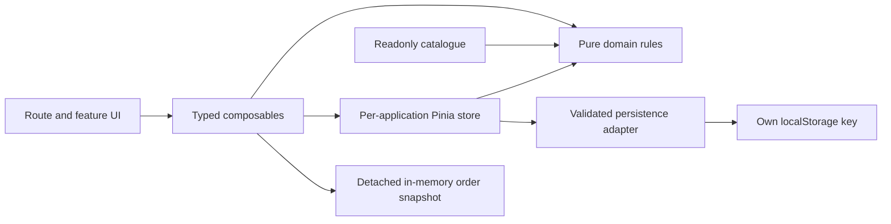

# Veyli Colour architecture

Veyli is a statically generated Nuxt storefront for an original fictional beauty brand. Its ten products and thirty named shades are finite local fixtures. The browser supports discovery, saved shades, editable colour stories and a simulated checkout; it does not need a commerce server.

## Responsibilities

| Boundary                  | Responsibility                                                                                        |
| ------------------------- | ----------------------------------------------------------------------------------------------------- |
| `app/pages/`              | Select a route's fixture and compose its feature components.                                          |
| `app/components/`         | Shared image, icon, native dialog, quantity, header and footer presentation.                          |
| `app/features/`           | Catalogue controls/cards, product gallery/purchase, colour-story slots, bag lines and checkout steps. |
| `app/composables/`        | Typed coordination between views, route queries, domain functions and the store.                      |
| `data/catalog.ts`         | Readonly product/shade identifiers, prices, stock, story tags and accurate image mappings.            |
| `domain/`                 | Pure filtering, cart transitions, compatibility, pricing, customer validation and order snapshots.    |
| `app/stores/shop.ts`      | One focused Pinia setup store for shared bag and saved product/shade pairs.                           |
| `adapters/persistence.ts` | Validate and serialize the store's versioned non-sensitive browser record.                            |

Both `~/components` and `~/features` are explicitly registered in Nuxt's component scan. Routes remain composition surfaces; business rules do not depend on Vue, Pinia, the DOM or browser storage.

## Where state belongs

The store owns source bag records and saved `{productId, shadeId}` choices. Resolved lines, the total piece count and integer-cent totals are derived. Identical variants merge; different shades remain separate. A saved unavailable shade remains a valid choice to revisit, while unavailable stock cannot enter the bag.

`useProductShade` owns the current product choice and quantity. `useLookBuilder` owns its editable draft and feedback. `useCheckout` owns form details, validation errors, the review step and the local confirmation. Header menus, gallery state and reset confirmation belong to their components.

The bag's open state lives in the root `app.vue` instance. A typed Vue provide/inject callback lets product and look features open it without putting temporary presentation state in the shopping store. There is no module-level mutable customer store.

## Rules and transitions

`domain/cart.ts` validates the entire proposed addition before returning a new bag. Unknown identifiers, malformed records, invalid quantities, unavailable shades or aggregate stock conflicts reject the operation without partially changing existing items. Prices come from the catalogue in integer cents. Standard delivery is €5 below €75 and included otherwise; `cartTotals` is the single calculation used by the bag and checkout.

`domain/looks.ts` matches explicit fixture story tags to lips, eyes and complexion accents. Skin tint has no story tags and is not automatically selected as a skin match. Removing a slot recomputes the subtotal; a nonempty reduced story can be added. Every remaining choice must be compatible and available, and the complete addition is validated atomically against the existing bag. Swatches illustrate colour families and do not predict a result on a person's skin.

`useQueryUpdates` serializes router updates against committed query state, so rapid filter changes compose rather than overwrite one another. Queued work is disabled when its scope is disposed. Deterministic server defaults are rendered first; known shade/story query choices are applied after mount to preserve static hydration.

## Persistence and hydration

Pinia setup-store state and its storage port are created per application instance. The client plugin reads `window.localStorage` only in Nuxt's `app:mounted` hook. Server rendering neither accesses browser storage nor loads another request's bag.

The adapter uses `veyli-colour:shop:v1` with a versioned envelope, bounded arrays and record validation. It checks known products/shades and safe positive quantities, merges duplicate records and clamps recovered bag quantities to current fixture stock. Invalid records are discarded; unknown versions, malformed or oversized JSON and blocked storage recover to a fresh non-sensitive state. Reset removes this key alone, preserving other demos on the same GitHub Pages origin.

The persisted schema contains only bag and saved shade choices. Contact fields, consent, payment details and confirmations are excluded.

## Checkout confirmation

`domain/customer.ts` validates a trimmed 2–100 character name, the supported unquoted email format, a listed destination and explicit demo consent. Format validation makes no mailbox or DNS claim.

`createOrderSnapshot` revalidates the whole bag using current fixture stock and prices. It copies primitive line values, matching shade images and calculated totals into newly frozen objects. Only the first name and destination are carried into this in-memory confirmation; the email, full name and consent are omitted. The UI supplies its reference, clears form details and empties the live bag after success. Later bag changes or a full saved-choice reset cannot alter the confirmed lines or total. Navigating away does not persist an order record.

## Static deployment choice

All sixteen application routes are explicitly generated under `/veyli-colour-nuxt/`. Nuxt's optional runtime build-manifest lookup is disabled with `experimental.appManifest: false`. This fixture app has no runtime data lookup or route-rule service to discover. In installed Nuxt 4.6.4, the payload client plugin schedules that lookup after readiness; a rapid-navigation WebKit check exposed its rejected background fetch. The supported opt-out removes that unnecessary request while runtime, hydration and direct-route assertions remain enabled. Reassess this choice before adding runtime fetching or build-update detection. See the [official configuration schema](https://github.com/nuxt/nuxt/blob/main/packages/schema/src/config/experimental.ts) and [maintainer explanation](https://github.com/nuxt/nuxt/discussions/25882).

The README and delivery notes carry the final commands, measured payloads, release evidence and limitations. Tests cover domain/store transitions separately from actual browser journeys; screenshots show rendered interfaces rather than embedded page mockups.
